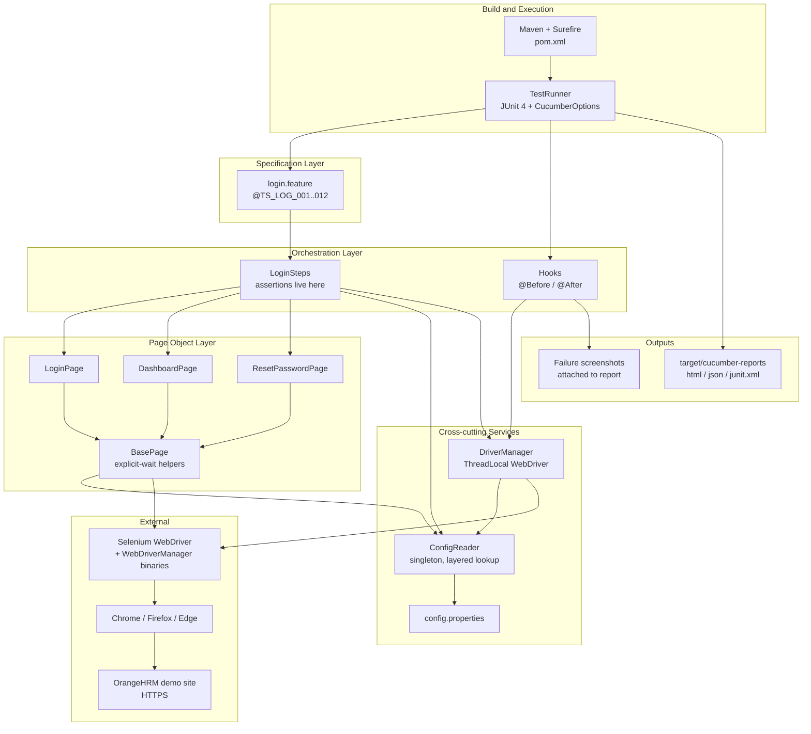
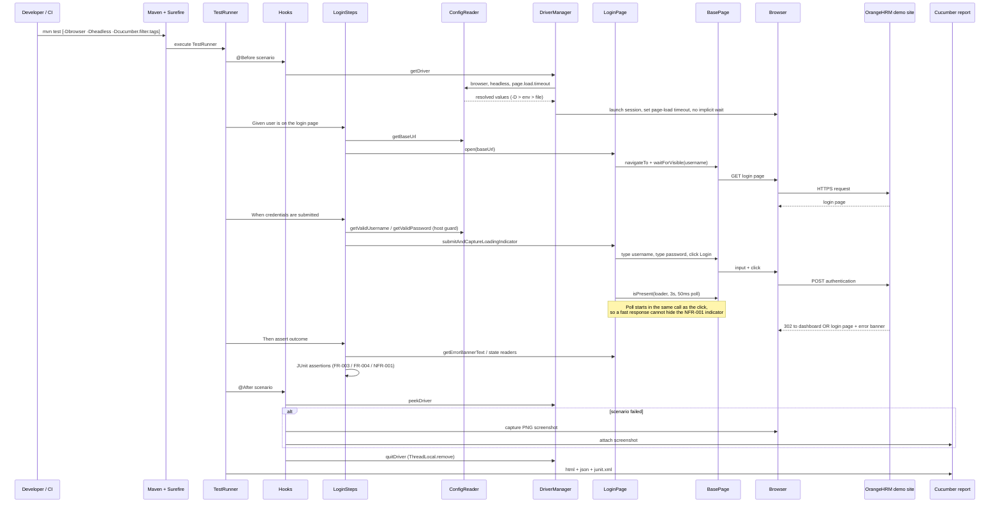
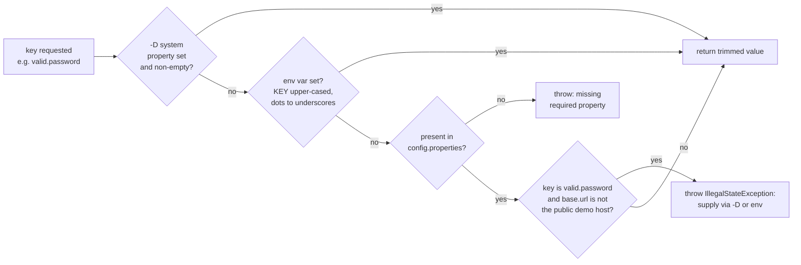

# Architecture

**Story:** `US-AUTH-002` — Customer Login & Authentication
**Upstream artifact:** `artifacts/requirements.md` (6 FRs, 2 NFRs, approved)
**Scope of this document:** the test-automation architecture that verifies
`FR-001`–`FR-006` and `NFR-001`–`NFR-002` against the public OrangeHRM demo
login page. The OrangeHRM application itself is a third-party system under
test, not a system this repository builds or deploys.

## Overview

A four-layer, single-module Maven test-automation architecture: Gherkin
specification (`*.feature`) → step definitions (orchestration + assertions) →
Page Objects (locators + business actions) → Selenium WebDriver, with two
cross-cutting services — `DriverManager` (per-thread browser lifecycle) and
`ConfigReader` (layered configuration and credential guarding). Each layer has
exactly one reason to change: a UI selector change touches only a Page Object,
a new acceptance criterion touches only a feature file plus step definitions.
Every requirement in `artifacts/requirements.md` is verified through a browser
against the live demo site; there is no application runtime, database, or API
authored here.

## Architectural Goals and Drivers

| Driver | Source ID | Architectural consequence |
| --- | --- | --- |
| Verify static login-page composition | `FR-001` | `LoginPage` must expose presence readers for every required control, including the footer and field placeholders. |
| Verify password masking without reading the secret | `FR-002` | Assertion reads the input's `type` DOM attribute — never the field's value — so no plaintext password enters the test process or report. |
| Verify authenticated redirect | `FR-003` | A separate `DashboardPage` Page Object owns post-login verification, keeping the login/dashboard boundary explicit; two submission paths (button, Enter key) are modelled as distinct `LoginPage` actions. |
| Verify generic rejection of invalid credentials | `FR-004` | `LoginPage` exposes the top-level error banner text so the exact, non-revealing message is asserted verbatim. |
| Verify inline per-field required validation | `FR-005` | Field-scoped locators (relative XPath anchored to each input) distinguish the Username error from the Password error; a class-name-only locator could not. |
| Verify forgot-password navigation | `FR-006` | A dedicated `ResetPasswordPage` Page Object asserts arrival by URL fragment plus a page-specific element. |
| Observe a transient in-flight indicator | `NFR-001` | The indicator is short-lived, so the poll must start in the same call as the submit click — not in a later Cucumber step. Drives the `submitAndCaptureLoadingIndicator` design and a fast polling interval. |
| Never expose credentials; never enumerate users | `NFR-002` | Credentials resolve through override-first configuration with a host guard; no component logs a credential value; transport is asserted as HTTPS. |
| Deterministic, isolated, repeatable runs | `NFR-001`, `NFR-002` | Explicit waits only (no implicit wait), fresh browser session per scenario, per-thread driver isolation. |

## Recommended Architecture

Keep the existing layered Page Object Model architecture and extend it. It
already satisfies the structural drivers above, and no requirement in
`artifacts/requirements.md` calls for a new module, a service, or a different
runner. The architecture is therefore **confirmed as-is, with three additive
extensions** needed to close genuine coverage gaps (see
[Requirement-to-Component Traceability](#requirement-to-component-traceability)):

1. Extend `LoginPage` with footer and placeholder readers so `FR-001` is fully
   verified rather than partially verified (`AD-008`).
2. Add a transport-scheme assertion so `NFR-002`'s HTTPS clause is verified in
   the suite rather than only by code review (`AD-009`).
3. Add a preventive HTTPS scheme guard to `ConfigReader.getBaseUrl()` so a
   credential can never be submitted to a cleartext target in the first place
   (`AD-010`; added by `DR-001` in the Step 3 design review).

All three extensions land inside existing components. No new layer, dependency,
or build plugin is introduced.

**Layer contract (enforced by `.claude/rules/code-quality.md` and code review):**

| Layer | May depend on | Must never |
| --- | --- | --- |
| Feature files | — (declarative Gherkin only) | Contain selectors, URLs, or credentials |
| Step definitions | Page Objects, `ConfigReader`, `DriverManager` | Invoke `WebDriver`/`WebElement`/`By`/wait APIs. A `WebDriver` reference may be held **only** to construct Page Objects (per `DR-009`) |
| Page Objects | `BasePage`, Selenium, `ConfigReader` | Contain assertions or test data |
| `BasePage` | Selenium, `ConfigReader` | Know about any specific page |
| `DriverManager` / `ConfigReader` | Selenium, JDK | Depend on pages or steps |

## Component Diagram

## Key Components and Responsibilities

| Component | Responsibility | FR/NFR |
| --- | --- | --- |
| `src/test/resources/features/login.feature` | Declares each acceptance criterion as a tagged Gherkin scenario; the executable statement of intent. Holds no selectors, URLs, or credentials. | `FR-001`–`FR-006`, `NFR-001` |
| `runner/TestRunner.java` | Single JUnit entry point; binds feature directory, glue packages, and report plugins. The only class Surefire includes. | All |
| `hooks/Hooks.java` | Per-scenario isolation: launches a fresh browser in `@Before`, quits it in `@After`, and attaches a PNG screenshot on failure via `peekDriver()`. | `NFR-002` (no credential or form state survives a scenario), reliability for all FRs |
| `stepdefinitions/LoginSteps.java` | Translates Gherkin steps into Page Object calls and owns **every** assertion. Also holds the `NFR-001` indicator observation captured during the submit step. | `FR-001`–`FR-006`, `NFR-001` |
| `pages/BasePage.java` | Single home for the `WebDriver`/`WebDriverWait` reference and all explicit-wait helpers (`waitForVisible`, `waitForClickable`, `type`, `click`, `getText`, `isDisplayed`, `isPresent`, `waitForUrlContains`). Keeps synchronization logic in one place. | Determinism for all; `NFR-001` via `isPresent` fast-poll |
| `pages/LoginPage.java` | Locators and business actions for the login page: open, enter username/password, submit by button or Enter key, click forgot-password, and read control presence, error banner, per-field required errors, password field `type`, and loading indicator. | `FR-001`, `FR-002`, `FR-003`, `FR-004`, `FR-005`, `FR-006`, `NFR-001`, `NFR-002` |
| `pages/DashboardPage.java` | Confirms the post-login landing state by URL fragment `dashboard/index`, header text, and user dropdown. | `FR-003` |
| `pages/ResetPasswordPage.java` | Confirms arrival at `requestPasswordResetCode` by URL fragment and page title. | `FR-006` |
| `driver/DriverManager.java` | Creates, exposes, and disposes one `WebDriver` per thread via `ThreadLocal`; selects chrome/firefox/edge and headless mode from config; applies page-load timeout and **no implicit wait** by design; cleans up a half-initialised browser so it cannot leak. | All; `NFR-002` (session isolation) |
| `config/ConfigReader.java` | Thread-safe singleton resolving every key as `-D` system property → environment variable → `config.properties`. Guards `valid.password`: throws unless an override was supplied or `base.url` still targets the public demo host. | `FR-003`, `NFR-002` |
| `src/test/resources/config.properties` | Declares `base.url`, `browser`, `headless`, `explicit.wait`, `page.load.timeout`, and the public demo credentials, with an in-file comment recording the scoped plaintext exception. | `FR-003`, `NFR-002` |
| `pom.xml` (Surefire, WebDriverManager) | Dependency and execution contract; WebDriverManager resolves browser driver binaries at runtime so no binary is committed or manually installed. | Deployment for all |
| `target/cucumber-reports/` | Observability surface: HTML for humans, JSON/JUnit XML for CI and the Verify agent (Step 7). | Evidence for all |

### Requirement-to-Component Traceability

| ID | Verifying component path | Scenario(s) | Coverage status |
| --- | --- | --- | --- |
| `FR-001` | `login.feature` → `LoginSteps.all_required_login_controls_should_be_displayed` → `LoginPage.findMissingLoginControls` | `@TS_LOG_008` | **Complete** (`TASK-005`, `TASK-006`) — logo, both fields, Login button, forgot-password link, footer copyright, and ≥1 footer social-link anchor are each asserted independently via the missing-controls collection, and both placeholder *values* are compared with `assertEquals` against literals declared in `login.feature`. Satisfies the condition `DR-002` set for this claim. See `AD-008`. |
| `FR-002` | `LoginSteps.the_password_field_should_mask_the_entered_characters` → `LoginPage.getPasswordFieldType` | `@TS_LOG_007` | Complete |
| `FR-003` | `LoginSteps` dashboard step → `LoginPage.login` / `submitWithEnterKey` + `DashboardPage.isDashboardPageDisplayed` | `@TS_LOG_001`, `@TS_LOG_012` | Complete (both submission paths) |
| `FR-004` | `LoginSteps.the_error_banner_should_be_displayed` → `LoginPage.getErrorBannerText` | `@TS_LOG_002`, `@TS_LOG_003`, `@TS_LOG_011` | Complete (all three invalid combinations) |
| `FR-005` | `LoginSteps` per-field validation steps → `LoginPage.isUsernameRequiredErrorDisplayed` / `isPasswordRequiredErrorDisplayed` | `@TS_LOG_004`, `@TS_LOG_005`, `@TS_LOG_006` | Complete |
| `FR-006` | `LoginSteps.the_user_should_be_redirected_to_the_reset_password_page` → `ResetPasswordPage` | `@TS_LOG_010` | Complete |
| `NFR-001` | `LoginSteps.the_user_submits_valid_credentials` → `LoginPage.submitAndCaptureLoadingIndicator` → `BasePage.isPresent` | `@TS_LOG_009` | Complete, with a documented proxy — `AC-007` says the indicator is *visible*, while `isPresent` polls DOM **presence**. Presence is an **accepted proxy** for visibility here: the indicator's lifetime is often under 100ms, and visibility polling would trade real reliability for marginal fidelity. Recorded rather than implied, per `DR-004`. |
| `NFR-002` | `ConfigReader.getValidPassword` host guard + `getBaseUrl` scheme guard (`AD-010`, `TASK-001`); `LoginPage.getPasswordFieldType` (never reads the value); generic-banner assertions; `LoginSteps.the_current_page_should_be_served_over_https` (`AD-009`, `TASK-004`); absence of credential logging in every component | `@TS_LOG_001`, `@TS_LOG_002`, `@TS_LOG_003`, `@TS_LOG_007`, `@TS_LOG_008`, `@TS_LOG_011` | **Complete** — non-enumeration and no-plaintext-on-screen are verified; the HTTPS transport clause is now both preventively guarded (`TASK-001`'s fail-closed scheme check in `ConfigReader.getBaseUrl()`, which runs before the browser navigates) and executed as defence in depth (`TASK-004`'s assertion on `@TS_LOG_001`/`@TS_LOG_008`). The no-logging clause remains code-review-only (`TASK-007`), per `artifacts/requirements.md` AC-008 — this distinction is preserved, not implied away by the HTTPS fix. See `DR-001`, `OQ-A002`. |

No orphans: every component above traces to at least one `FR`/`NFR`, and every
`FR`/`NFR` traces to at least one component.

## Data Flow

Authentication attempt, from Maven invocation to assertion and report
(covers `FR-003`, `FR-004`, and `NFR-001`):

Configuration resolution, applied to every key (realizes `NFR-002`):

## Technology Choices

| Decision | Choice | Rationale | Trade-offs |
| --- | --- | --- | --- |
| `AD-001` Browser automation | Selenium WebDriver 4.27.0 | Mandated by the project's stated stack; W3C-standard protocol, cross-browser, mature. Required to verify real rendering for `FR-001`, masking for `FR-002`, and the in-flight indicator for `NFR-001`. | Slower and more flake-prone than request-level testing; needs a real browser on the runner. |
| `AD-002` Specification format | Cucumber JVM 7.20.1 (Gherkin) | Gives each acceptance criterion in `artifacts/requirements.md` a one-to-one executable scenario, readable by non-engineers, and tag-addressable (`@TS_LOG_###`) for selective runs. | Extra indirection layer; step-text drift must be managed. |
| `AD-003` Assertion runner | JUnit 4.13.2 via `cucumber-junit` | Matches the declared stack and the existing `@RunWith(Cucumber.class)` entry point; universally supported by Surefire and CI report parsers. | JUnit 4 is legacy; a JUnit 5 move would mean replacing the runner with the Cucumber JUnit Platform engine. No requirement justifies that now. |
| `AD-004` Build and dependencies | Maven 3.9+ single module | Declared stack; `mvn test` is the one command for the whole suite, and Surefire emits the XML the Verify agent consumes. | Single module means no compile-time barrier between layers; layering is enforced by review and `.claude/rules/*`, not by the build. |
| `AD-005` Driver binary provisioning | WebDriverManager 5.9.2 | Resolves and caches the matching driver binary at runtime, so no binary is committed and no manual PATH setup is needed on a dev machine or CI runner. | Needs network access on first run per browser version; adds a third-party dependency in the startup path. |
| `AD-006` Test structure | Page Object Model with a shared `BasePage` | Isolates OrangeHRM's volatile `oxd-*` selectors to one class per page, so a UI change touches one file. Centralising waits in `BasePage` keeps page classes free of Selenium boilerplate and makes timing behaviour uniform. | Inheritance couples all pages to `BasePage`; it must stay page-agnostic to avoid becoming a dumping ground. |
| `AD-007` Synchronization | Explicit waits only — **no implicit wait anywhere** | Mixing implicit and explicit waits yields unpredictable compounded timeouts. Explicit-only also makes a negative check (`isDisplayed` returning `false`) cost exactly its own timeout, which matters for `FR-005` and for not-displayed assertions. | Every new interaction must choose its wait deliberately; no global safety net. |
| `AD-008` `FR-001` completeness | Add footer and placeholder readers to `LoginPage`, asserted from `LoginSteps`. Assert the footer **copyright element** and **at least one social-link anchor** as distinct controls, and compare **both `placeholder` attribute values** to expected literals passed in as Gherkin step parameters. `LoginPage` returns the collection of *missing* required controls rather than a single short-circuited boolean. | `FR-001` names the footer (copyright + social links) and both placeholders explicitly; the current control check omits them. Container-presence-only would leave `FR-001` effectively uncovered while reporting "Complete" (`DR-002`). Returning the missing-control set makes a failure diagnosable from the report alone and avoids eight stacked 10s timeouts behind one `assertTrue` (`DR-003`). Expected text stays in Gherkin so the layer contract ("Page Objects must never contain test data") holds. | Footer social links are third-party markup and may be the most brittle locators in the suite; scope them narrowly — assert anchor presence, not `href` targets. Placeholder literals couple the suite to the demo site's English UI copy (localisation is out of scope upstream). |
| `AD-009` `NFR-002` transport (defence in depth) | Assert the login page and post-submit URL use the `https` scheme, read via `BasePage.getCurrentUrl`. **This is not the primary HTTPS control** — see the preventive guard in `AD-010`. | A `Then`-step URL assertion necessarily runs *after* `LoginPage.login()` has already typed and POSTed the password, so it cannot prevent a cleartext submission (`DR-001`). It remains worthwhile for the case it genuinely catches: an HTTPS target that redirects or downgrades to `http` mid-session, which would otherwise pass silently. | Verifies the scheme only, not certificate validity or absence of mixed content. Full transport inspection would need a proxy (e.g. BrowserMob) — unjustified for this scope. |
| `AD-010` Credential handling | Override-first `ConfigReader`, the demo-host guard on `getValidPassword()`, **and** a preventive scheme guard: `getBaseUrl()` fails closed unless the resolved URL scheme is `https`, gated by an explicit default-`false` opt-out (e.g. `allow.insecure.base.url`) for a deliberate local non-TLS sandbox. | Lets CI inject real credentials via `-Dvalid.password` or `VALID_PASSWORD` with no code change, while structurally preventing the committed demo password from being fired at a non-public target. The scheme guard closes `DR-001`: the host guard compares only the host (so `http://`+demo host passes it), and supplying a `valid.password` override bypasses the host check entirely by design — so the CI path recommended under Deployment had no transport check at all. Failing closed before the browser navigates is the only point at which cleartext submission can be prevented, per `code-quality.md` ("never transmit passwords in plain text", "fail closed on security-relevant errors"). | A plaintext demo credential remains in the repository as a documented, scoped exception. The opt-out is a deliberate escape hatch and must stay default-`false`. **The existing demo-host guard must not be removed, narrowed, or widened — the scheme guard is additive.** |
| `AD-011` Logging | SLF4J 2.0.16 (`slf4j-simple`) at component boundaries only; **never** log a credential, a field value, or a resolved password | Satisfies `NFR-002`'s no-plaintext-in-logs clause by construction rather than by redaction. Current logging covers browser/headless selection, scenario start/finish, and failure paths only. | Console-only output, no structured log file; sufficient because the Cucumber report is the primary evidence artifact. |
| `AD-012` Parallelism | `ThreadLocal` driver — parallel-**ready**, parallel execution not enabled | Per-thread isolation costs nothing now and avoids a rewrite later, but no requirement asks for suite speed, and the public demo site should not be hammered with concurrent sessions. | The parallel path is unexercised, so latent cross-scenario coupling would only surface when it is switched on. |
| `AD-013` Failure evidence | PNG screenshot attached to the Cucumber report on failure, captured via `peekDriver()` | A screenshot at the moment of failure is the fastest route to a root cause for UI assertions. `peekDriver()` never creates a driver, so a failed `@Before` cannot spawn a second browser during teardown. | Screenshots inflate report size; a screenshot could in principle capture on-screen input, which is why `FR-002` masking is itself verified. |

## SDLC Pipeline Components

| Type | Name | Purpose |
| --- | --- | --- |
| Agent | Requirements Agent (Step 1) | Produced the approved `artifacts/requirements.md` this architecture consumes. |
| Agent | Architect Agent (Step 2) | Owns this document. |
| Agent | Design Review Agent (Step 3) | Next step; reviews this architecture and raises `DR-###` findings against the sections and `AD-###` decisions here. |
| Agent | Planner Agent (Step 4) | Converts `AD-008`, `AD-009`, and any `DR-###` into `TASK-###` entries citing these sections. |
| Agent | Implementation Agent (Step 5) | Implements each `TASK-###` within the layer contract above. |
| Agent | Review Agent (Step 6) | Code review against `.claude/rules/code-quality.md`, including the `NFR-002` no-credential-logging check. |
| Agent | Verify Agent (Step 7) | Runs the suite and reconciles `target/cucumber-reports/` output against `FR`/`NFR` coverage. |
| Agent | PR Agent (Step 8) | Opens the PR with a traceability matrix and updates `artifacts/CHANGELOG.md`. |
| Skill | `design-architecture` | Workflow that produced this document. |
| Skill | `sdlc-traceability` | Stable `FR-###`/`NFR-###`/`DR-###`/`TASK-###` ID discipline across artifacts. |
| Skill | `design-review`, `plan-implementation`, `implement-task`, `code-review`, `verify-implementation`, `create-pr` | Downstream step workflows consuming this document. |
| Rule | `.claude/rules/code-quality.md` (`**/*.java`) | OWASP-safe, DRY, clear-code standards; the login-specific guidance underpins `NFR-002` and `AD-011`. |
| Rule | `.claude/rules/tests.md` | Coverage, structure, and determinism standards. **Auto-applies here** — its frontmatter includes `**/*.java`, which matches every Java file in this repository (`DR-005`; an earlier note in this document and in `.claude/CLAUDE.md` wrongly said it does not). **Precedence (`DR-006`):** its coverage, determinism, and quality clauses bind in full; its unit-test/mocking *structure* clause is satisfied by the Gherkin + Page Object layering, and **no unit-test or mock layer is in scope for `US-AUTH-002`** unless an approved `TASK-###` introduces one. |
| Rule | `.claude/rules/sdlc-artifacts.md` (`artifacts/**/*.md`) | Structure, traceability, and writing standards this document follows. |
| Hook | `hook_implementation_task_gate.java` (`PreToolUse`, `Bash(git commit*)`) | Blocks a commit staging `src/` changes without a `TASK-###` in the message; the enforcement point for the Step 5 traceability gate. Commits touching only `artifacts/*.md` are unaffected. |
| Hook | `hook_pre_edit`, `hook_scan_secrets`, `hook_autoformat`, `hook_post_edit`, `hook_log_commands`, `hook_test_summary` | Wired in `.claude/settings.json` but **not implemented** — each silently no-ops. Downstream agents must not assume secret scanning, formatting, or stop-time test summaries occur. |
| Command | `/00-orchestrator.prompt` | Pipeline entry point; maintains `artifacts/ORCHESTRATION_LOG.md`. |

## Security Considerations

The system under test owns authentication; this framework's security duty is to
verify observable guarantees without itself becoming a disclosure channel.

- **Authentication / authorization.** Out of scope to implement. The framework
  verifies the externally observable contract: valid pair → dashboard
  (`FR-003`); any non-matching pair → stay on the login page with a generic
  banner (`FR-004`); blank field → inline `Required` (`FR-005`).
- **Non-enumeration (`NFR-002`).** `@TS_LOG_002`, `@TS_LOG_003`, and
  `@TS_LOG_011` cover wrong-password, unknown-username, and both-wrong, and all
  three assert the identical literal `"Invalid credentials"` with
  `assertEquals`. Any future message that leaks which field was wrong fails at
  least one of these.
- **No plaintext on screen (`FR-002`, `NFR-002`).** Masking is verified by
  reading the password input's `type` DOM attribute, never its value. The
  framework therefore never pulls a password out of the browser.
- **No plaintext in logs (`NFR-002`, `AD-011`).** No component logs a
  credential today. `DriverManager` logs browser and headless state, `Hooks`
  logs scenario name and status, and `LoginSteps` logs nothing. Any new log
  statement that interpolates a username or password value is a review-blocking
  defect. **Control ownership (`DR-012`):** because `hook_scan_secrets` is
  unimplemented and silently no-ops, the Step 6 code review is the *sole active
  control* for this rule — that check is mandatory and non-skippable, and the
  intended hook must not be treated as if it were operating.
- **Transport (`NFR-002`, `AD-010`, `AD-009`).** The committed `base.url` is
  HTTPS and the demo host redirects to HTTPS, but `base.url` is a freely
  overridable key. The **preventive** control is the `getBaseUrl()` scheme guard
  (`AD-010`): it fails closed before the browser navigates, so no credential can
  be submitted to an `http://` target. This matters because the host guard on
  `getValidPassword()` compares only the host, and is bypassed entirely whenever
  a `valid.password` override is supplied — the exact CI path recommended under
  Deployment (`DR-001`). `AD-009`'s executed scheme assertion is retained as
  defence in depth against a mid-session redirect or downgrade; it runs after the
  password has already been submitted and therefore cannot be the primary control.
- **Report artifacts as a disclosure channel (`AD-013`, `DR-008`).** Failure
  screenshots and `cucumber.json` capture whatever is on screen. The password is
  safe by construction (`FR-002` masking is itself verified), but the **username**
  renders in plaintext and is embedded in the report. For the public `Admin` demo
  account this is a non-issue. When `base.url` targets a non-demo environment with
  injected credentials, `target/cucumber-reports/` and `target/surefire-reports/`
  must be treated as sensitive and not published to an untrusted artifact store.
- **Secret management (`AD-010`).** Precedence `-D` → environment → file lets CI
  inject real credentials without touching the repository. The
  `getValidPassword()` demo-host guard throws if the committed demo password
  would be used against a non-demo `base.url`. **This guard must not be removed
  or widened** by any downstream task.
- **Input validation boundary.** The only external inputs are configuration
  values and Gherkin step parameters. `ConfigReader` fails fast on a missing
  key, and unsupported step parameters are rejected explicitly (for example the
  unsupported-link branch in the forgot-password step) rather than silently
  passing.
- **Scoped exception.** Plaintext `valid.username` / `valid.password` in
  `config.properties` are OrangeHRM's own public demo values, accepted only
  while the target is the public demo host, documented in the file and in
  `artifacts/requirements.md`. Revisit before pointing at any non-public
  environment.

## Reliability and Observability

**Isolation.** `Hooks` runs per scenario, not per suite: a fresh browser
session per scenario means no cookie, session, or leftover form state can mask
a defect — which matters most for the `FR-005` validation scenarios.

**Timeouts and failure handling.**

| Concern | Mechanism | Value |
| --- | --- | --- |
| Element visibility / clickability | `BasePage` `WebDriverWait` | `explicit.wait` = 15s |
| Page load | `DriverManager` page-load timeout | `page.load.timeout` = 30s |
| Transient loading indicator (`NFR-001`) | `isPresent` fast poll | 3s timeout, 50ms polling |
| Negative "not displayed" checks | Per-call `isDisplayed(locator, timeoutSeconds)` | 5–10s as called |

- A `TimeoutException` in `isDisplayed`/`isPresent` is translated into a
  first-class `false`, so "not displayed" is a real outcome rather than a
  swallowed error. Every other timeout propagates and fails the scenario.
- **No retries.** Scenarios are deterministic by design; a silent retry would
  hide both product defects and framework flake. Failure is the signal.
- `DriverManager.initDriver` quits a browser it started but has not yet stored
  in the `ThreadLocal`, so a configuration failure cannot orphan a process.
- `Hooks.tearDown` captures the screenshot inside its own try/catch and quits
  the driver in a `finally`, so a dead session during screenshot capture can
  neither mask the original failure nor leak the browser.
- **External dependency risk.** The suite runs against a live third-party demo
  site; its availability is the dominant failure mode and is outside this
  architecture's control (see Risks).

**Observability.** `cucumber-html-report.html` for humans (with failure
screenshots inline), `cucumber.json` and `cucumber-junit.xml` for CI and the
Verify agent, Surefire XML in `target/surefire-reports/`, and SLF4J console
logs for driver and scenario lifecycle. Tag-filtered reruns
(`-Dcucumber.filter.tags="@TS_LOG_001"`) are the primary debugging loop.

## Scalability and Performance

No `FR`/`NFR` sets a suite-duration or throughput target, so the architecture
optimises for determinism over speed.

- **Current cost.** 12 scenarios, each with a full browser launch and teardown;
  wall-clock time is dominated by browser startup plus live-site latency.
- **Primary bottleneck.** Sequential execution with one browser launch per
  scenario.
- **Scaling path, in order of value:** (1) enable Cucumber/Surefire parallel
  execution — architecturally ready today via the `ThreadLocal` driver
  (`AD-012`), requiring no production-code change; (2) run headless
  (`-Dheadless=true`) in CI to cut per-session overhead; (3) distribute across a
  Selenium Grid or container matrix, which `DriverManager` could support behind
  a `RemoteWebDriver` branch if a cross-browser requirement ever appears.
- **Deliberate constraint.** Parallelism stays off until a requirement needs
  it: the target is a shared public demo instance, and concurrent sessions
  against it add flake and are impolite.
- **Known scaling limit.** `ConfigReader` is an immutable-after-load singleton
  and safe to share; `LoginSteps` field state (the `NFR-001` captured flag) is
  per-scenario-instance and therefore parallel-safe. The untested variable is
  the demo site's tolerance for concurrent logins, not the framework.

## Deployment

This repository ships no runtime artifact; "deployment" means reproducible
execution of the suite.

- **Build/run:** `mvn test` compiles `src/test/java`, and Surefire executes
  only `**/TestRunner.java`, which drives all feature files.
- **Prerequisites:** Java 21+, Maven 3.9+, a local browser (Chrome by default).
  `pom.xml` sets `maven.compiler.source`/`target` to 11, which targets Java 11
  bytecode **without** API-level enforcement — unlike `maven.compiler.release`, it
  does not stop code referencing a post-11 API (`DR-010`). Harmless here because
  the documented prerequisite is Java 21+. WebDriverManager fetches the driver
  binary at runtime, so no binary is committed or manually installed.
- **Environment overrides:** any `config.properties` key via `-Dkey=value` or an
  upper-cased, underscore-separated environment variable. **Use the exact property
  keys** — `-Dbase.url=`, `-Dvalid.username=`, `-Dvalid.password=`, `-Dbrowser=`,
  `-Dheadless=`, `-Dexplicit.wait=`, `-Dpage.load.timeout=`. A misspelled key such
  as `-DbaseUrl=` is silently ignored and the run continues against the committed
  value (`DR-007`; `.claude/CLAUDE.md` currently documents the wrong spelling —
  see `OQ-D001` in `artifacts/design-review.md`). Typical CI invocation:
  `mvn test -Dheadless=true -Dbrowser=chrome` with `VALID_USERNAME`/`VALID_PASSWORD`
  injected from the CI secret store when targeting a non-demo environment — which
  must still be an `https://` target, per the `AD-010` scheme guard.
- **Selective execution:** `mvn test -Dcucumber.filter.tags="@TS_LOG_001"` for a
  single scenario; tag expressions such as `@negative or @validation` for a
  subset.
- **CI/CD:** no pipeline definition exists in this repository (`Not Found`). The
  intended contract is a single `mvn test -Dheadless=true` step publishing
  `target/cucumber-reports/` and `target/surefire-reports/` as build artifacts,
  with `testFailureIgnore=false` already ensuring a failing scenario fails the
  build. Creating that workflow is outside this story's scope; see `OQ-A003`.

## Assumptions and Constraints

- The OrangeHRM public demo instance at
  `opensource-demo.orangehrmlive.com` is reachable from the runner and keeps
  responding with the `Admin`/`admin123` account and the current `oxd-*` DOM
  structure. **Assumption** — not controlled by this project.
- The application under test is third-party and unmodifiable. Every requirement
  is verified through the browser UI; no server-side, API, or database
  assertion is possible. Consistent with the out-of-scope list in
  `artifacts/requirements.md`.
- The existing stack (Selenium, Cucumber, JUnit 4, Maven, POM) is a **mandated
  constraint** from `.claude/CLAUDE.md`, not an open technology choice.
- `US-AUTH-002` is the authoritative story ID, per resolved `OQ-001` in
  `artifacts/requirements.md`. **Confirmed decision.**
- Chrome is the default browser; Firefox and Edge are supported by
  `DriverManager` but no requirement mandates a cross-browser matrix (explicitly
  out of scope upstream), so no browser matrix is run by default.
- `pom.xml` sets `maven.compiler.source`/`target` to 11 while the documented
  prerequisite is Java 21+. Targeting 11 bytecode and running on a 21+ JVM is
  intentional-and-valid; no requirement depends on a newer language level. Note
  that `source`/`target` is weaker than `maven.compiler.release` — it does not
  enforce the Java 11 API surface (`DR-010`). **Assumption** — a consistency
  observation, not a defect; switching to `release` is deferred housekeeping.
- `artifacts/requirements.md` is approved and authoritative. This document adds
  no architectural driver absent from it; `AD-008` and `AD-009` close coverage
  gaps against existing IDs rather than introducing new requirements.
- Scenarios `@TS_LOG_001`–`@TS_LOG_012` already exist and are the baseline.
  Per resolved `OQ-002`, the five scenarios beyond the PRD's original seven are
  confirmed-covered by `FR-001`, `FR-006`, and `NFR-001` — downstream agents
  should not re-litigate that scope.
- Only `hook_implementation_task_gate.java` is implemented; the other hooks in
  `.claude/settings.json` no-op. **Constraint** — no automated secret scanning
  or formatting is in force.

## Risks and Mitigations

| Risk | Likelihood | Impact | Mitigation |
| --- | --- | --- | --- |
| Live public demo site is down, slow, rate-limited, or has its demo data reset, failing the suite for non-product reasons | High | High | Keep timeouts generous (`AD-007` values); no retries so the failure is visible rather than masked; failure screenshots plus URL assertions distinguish "site down" from "product defect"; `base.url` is overridable to point at a private instance. **Classification rule for Step 7 (`DR-011`):** a run in which the login page never renders — the `Given` step or the login-page URL assertion fails, with a blank or error screenshot — is an **environmental** failure and must be reported as such in `artifacts/verification-report.md`, not as an `FR`/`NFR` verification failure. |
| OrangeHRM upgrade changes `oxd-*` CSS classes or DOM nesting, breaking locators | Medium | Medium | All selectors are confined to Page Object classes (`AD-006`), so repair is one file per page; prefer stable attributes (`By.name("username")`, `button[type='submit']`) over generated class names. |
| Transient `NFR-001` loading indicator is missed on a fast response, causing intermittent `@TS_LOG_009` failures | Medium | Medium | `submitAndCaptureLoadingIndicator` starts the poll in the same call as the click, with a 50ms polling interval — already mitigated by design; do not refactor the capture into a separate `Then` step. |
| Footer/social-link locators added for `FR-001` prove brittle (third-party markup, lazy loading) | Medium | Low | Scope locators narrowly to the footer container; assert presence only, not text or link targets; keep them in `LoginPage` so a fix is local. See `OQ-A001`. |
| A future change logs a credential or widens the `getValidPassword()` host guard, breaching `NFR-002` | Low | High | Guard documented as untouchable here, in `.claude/CLAUDE.md`, and in `config.properties`; `AD-011` makes credential logging a review-blocking defect; the intended `hook_scan_secrets` hook would add automation once implemented. |
| Plaintext demo credentials in `config.properties` are copied into a non-public context | Low | High | `getValidPassword()` host guard fails closed; the override path (`-D`/env) needs no code change; the in-file comment states the revisit trigger. |
| Enabling parallel execution later surfaces latent cross-scenario coupling | Low | Medium | `ThreadLocal` driver plus per-scenario browser and per-instance step state are parallel-safe by construction (`AD-012`); treat the first parallel run as an explicit validation exercise. |
| WebDriverManager cannot reach the network on a locked-down runner, so no driver binary resolves | Low | Medium | Cached binaries persist between runs; WebDriverManager supports pinning and an offline/mirror configuration if a restricted CI runner is adopted. |
| `.claude/rules/tests.md`'s broad `**/*.java` glob makes its unit-test/mocking structure clause apply to a repository that has no unit-test layer, inviting out-of-scope work in Step 5 or a spurious Step 6 finding | Medium | Low | Precedence recorded in the SDLC Pipeline Components table (`DR-006`): coverage and determinism clauses bind; the structure clause is satisfied by the Gherkin + Page Object layering. Tightening the globs is housekeeping outside this story. *(Supersedes an earlier row that wrongly claimed `tests.md` does not auto-apply here — see `DR-005`.)* |

## Open Questions

- **`OQ-A001` (`FR-001`, `AD-008`) — How should the footer and placeholder
  assertions be added?** `FR-001` requires the footer (copyright + social links)
  and both field placeholders, which `@TS_LOG_008` does not currently assert.
  Recommendation: extend `@TS_LOG_008` and
  `LoginPage.areAllLoginControlsDisplayed` rather than adding a new scenario, so
  `FR-001` keeps a single scenario mapping and the traceability table in
  `artifacts/requirements.md` stays unchanged. Needs confirmation because the
  alternative (a new `@TS_LOG_013`) would change that table.
- **`OQ-A002` (`NFR-002`, `AD-009`) — Should the HTTPS clause get an executed
  assertion?** `artifacts/requirements.md` AC-008 records that no dedicated
  scenario exists and that HTTPS/no-logging are covered by code review.
  Recommendation: add a cheap scheme assertion to an existing scenario so the
  clause is executed rather than asserted on paper. This would update AC-008's
  coverage note, so it needs sign-off before the Planner creates a task.
- **`OQ-A003` (Deployment) — Is a CI workflow in scope for this story?** No
  pipeline definition exists in the repository (`Not Found`). The suite is
  CI-ready (`mvn test -Dheadless=true`), but authoring a workflow file is not
  traceable to any `FR`/`NFR`. Recommendation: leave out of scope and track
  separately.
- **`OQ-A004` (Scalability, `AD-012`) — Confirm parallel execution stays
  disabled?** Recommendation: keep it off; no requirement targets suite
  duration, and concurrent sessions against the shared public demo instance
  increase flake. Raise only if a future runtime budget appears.

None of these four blocks the Design Review or Planner steps: `OQ-A001` and
`OQ-A002` affect the scope of two additive tasks, while `OQ-A003` and `OQ-A004`
recommend holding the status quo.

### Resolution (Step 3, user decision)

All four open questions are **closed** at the architect's recommended defaults:

| ID | Resolution |
| --- | --- |
| `OQ-A001` | **Confirmed** — extend the existing `@TS_LOG_008` scenario; no new tag, so the `artifacts/requirements.md` traceability table is unchanged. Scope refined by `DR-002`/`DR-003`. |
| `OQ-A002` | **Confirmed** — add the executed HTTPS assertion. `DR-001` additionally makes the primary control preventive (`AD-010`), with `AD-009` as defence in depth. |
| `OQ-A003` | **Out of scope.** No CI pipeline file exists and none traces to any `FR`/`NFR`. Its absence is **not** a gap and must not be raised as a finding by any downstream agent. |
| `OQ-A004` | **Out of scope.** Parallel execution stays intentionally disabled; `AD-012`'s `ThreadLocal` driver is parallel-*ready* only. **Not** a gap. |

Design-review findings `DR-001`–`DR-012` are recorded in
`artifacts/design-review.md`; the accepted ones are already reflected above.
Two new non-blocking questions (`OQ-D001`, `OQ-D002`) are tracked there.
