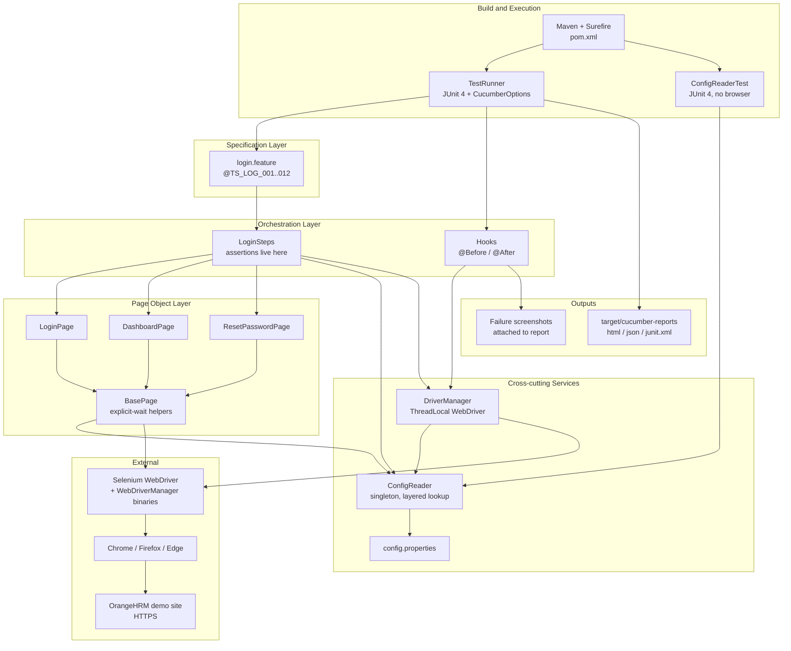
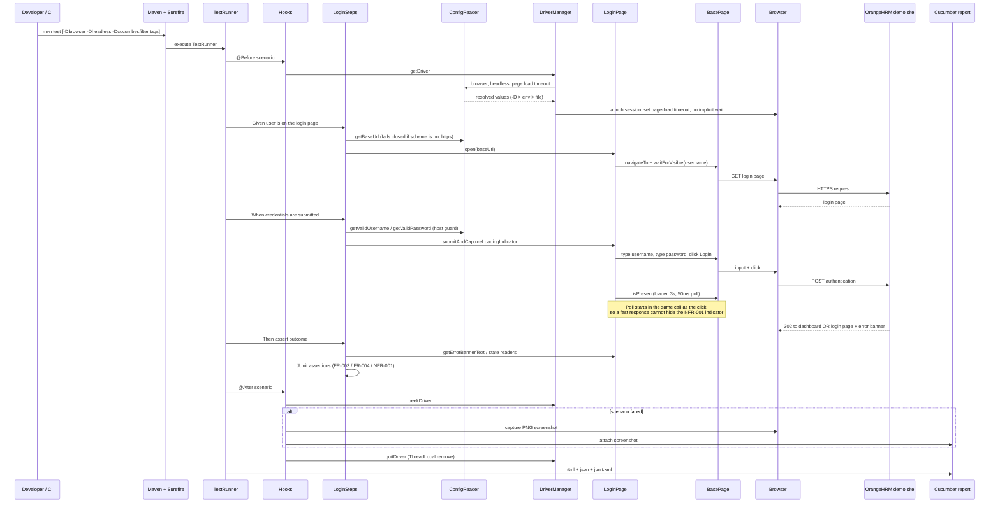
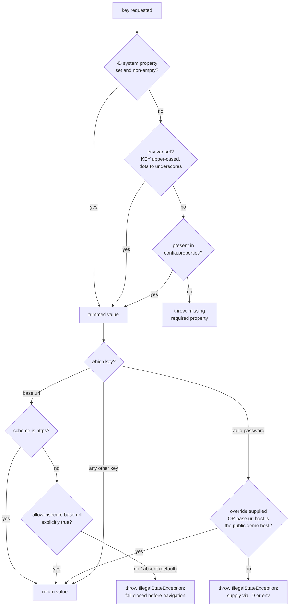

# Architecture

**Story:** `US-AUTH-002` — Customer Login & Authentication
**Upstream artifact:** `artifacts/requirements.md` (6 FRs, 2 NFRs, approved)
**Scope of this document:** the test-automation architecture that verifies
`FR-001`–`FR-006` and `NFR-001`–`NFR-002` against the public OrangeHRM demo
login page. The OrangeHRM application itself is a third-party system under
test, not a system this repository builds or deploys.

**Document status (pipeline restart).** This is a re-issue of the architecture
for an **unchanged codebase**. Decision IDs `AD-001`–`AD-013` are carried
forward unchanged from the prior cycle per `sdlc-traceability` ("assign IDs
once and never reuse or renumber them"); they are already load-bearing in
`artifacts/design-review.md` (`DR-001`–`DR-012`), `artifacts/impl-plan.md`
(`TASK-001`–`TASK-009`), and in-code comments. Every section below was
re-verified against the current contents of `src/`, `pom.xml`, and
`.claude/` rather than copied forward. Three facts had drifted since the prior
cycle and are corrected here, and one genuinely new decision point was found
and assigned the next free ID (`AD-014`) — see
[Changes in this re-issue](#changes-in-this-re-issue).

## Overview

A four-layer, single-module Maven test-automation architecture: Gherkin
specification (`*.feature`) → step definitions (orchestration + assertions) →
Page Objects (locators + business actions) → Selenium WebDriver, with two
cross-cutting services — `DriverManager` (per-thread browser lifecycle) and
`ConfigReader` (layered configuration and credential guarding) — plus one
narrow JUnit unit-test class covering `ConfigReader`'s security guards. Each
layer has exactly one reason to change: a UI selector change touches only a
Page Object, a new acceptance criterion touches only a feature file plus step
definitions. Every requirement in `artifacts/requirements.md` is verified
through a browser against the live demo site; there is no application runtime,
database, or API authored here.

## Architectural Goals and Drivers

| Driver | Source ID | Architectural consequence |
| --- | --- | --- |
| Verify static login-page composition | `FR-001` | `LoginPage` must expose presence readers for every required control, including the footer and field placeholders. |
| Verify password masking without reading the secret | `FR-002` | Assertion reads the input's `type` DOM attribute — never the field's value — so no plaintext password enters the test process or report. |
| Verify authenticated redirect | `FR-003` | A separate `DashboardPage` Page Object owns post-login verification, keeping the login/dashboard boundary explicit; two submission paths (button, Enter key) are modelled as distinct `LoginPage` actions. |
| Verify generic rejection of invalid credentials | `FR-004` | `LoginPage` exposes the top-level error banner text so the exact, non-revealing message is asserted verbatim. |
| Verify inline per-field required validation | `FR-005` | Field-scoped locators (relative XPath anchored to each input) distinguish the Username error from the Password error; a class-name-only locator could not. |
| Verify forgot-password navigation | `FR-006` | A dedicated `ResetPasswordPage` Page Object asserts arrival by URL fragment plus a page-specific element. |
| Observe a transient in-flight indicator | `NFR-001` | The indicator is short-lived, so the poll must start in the same call as the submit click — not in a later Cucumber step. Drives the `submitAndCaptureLoadingIndicator` design and a fast polling interval. |
| Never expose credentials; never enumerate users | `NFR-002` | Credentials resolve through override-first configuration with a host guard and a fail-closed HTTPS scheme guard; no component logs a credential value; transport is also asserted in the suite. |
| Deterministic, isolated, repeatable runs | `NFR-001`, `NFR-002` | Explicit waits only (no implicit wait), fresh browser session per scenario, per-thread driver isolation. |

## Recommended Architecture

Keep the existing layered Page Object Model architecture. It satisfies every
structural driver above, and no requirement in `artifacts/requirements.md`
calls for a new module, a service, or a different runner. The architecture is
**confirmed as-is**: the three additive extensions proposed in the prior cycle
are now implemented in `src/` and verified present during this re-issue.

| Extension | Decision | Implemented as |
| --- | --- | --- |
| Footer and placeholder readers so `FR-001` is fully verified | `AD-008` | `LoginPage.findMissingLoginControls()`, `getUsernamePlaceholder()`, `getPasswordPlaceholder()` |
| Executed transport-scheme assertion for `NFR-002` (defence in depth) | `AD-009` | `LoginSteps.the_current_page_should_be_served_over_https()` |
| Preventive fail-closed HTTPS guard so a credential can never reach a cleartext target | `AD-010` (raised by `DR-001`) | `ConfigReader.getBaseUrl()` + `allow.insecure.base.url` default-`false` opt-out |

All three landed inside existing components. No new layer, dependency, or build
plugin was introduced; the only build change was a Surefire include
(`AD-014`).

**Layer contract (enforced by `.claude/rules/code-quality.md` and code review):**

| Layer | May depend on | Must never |
| --- | --- | --- |
| Feature files | — (declarative Gherkin only) | Contain selectors, URLs, or credentials |
| Step definitions | Page Objects, `ConfigReader`, `DriverManager` | Invoke `WebDriver`/`WebElement`/`By`/wait APIs. A `WebDriver` reference may be held **only** to construct Page Objects (per `DR-009`) |
| Page Objects | `BasePage`, Selenium, `ConfigReader` | Contain assertions or test data |
| `BasePage` | Selenium, `ConfigReader` | Know about any specific page |
| `DriverManager` / `ConfigReader` | Selenium, JDK | Depend on pages or steps |
| Unit tests (`*Test.java`) | The single class under test, JUnit | Launch a browser, hit the network, or depend on Page Objects (`AD-014`) |

## Component Diagram

## Key Components and Responsibilities

| Component | Responsibility | FR/NFR |
| --- | --- | --- |
| `src/test/resources/features/login.feature` | Declares each acceptance criterion as a tagged Gherkin scenario; the executable statement of intent. 12 scenarios, `@TS_LOG_001`–`@TS_LOG_012`. Holds no selectors, URLs, or credentials. | `FR-001`–`FR-006`, `NFR-001`, `NFR-002` |
| `runner/TestRunner.java` | Cucumber entry point; binds the feature directory, the glue packages (`com.orangehrm.stepdefinitions`, `com.orangehrm.hooks`), and the `pretty`/`summary`/html/json/junit report plugins. | All |
| `hooks/Hooks.java` | Per-scenario isolation: launches a fresh browser in `@Before`, quits it in `@After`, and attaches a PNG screenshot on failure via `peekDriver()`. | `NFR-002` (no credential or form state survives a scenario), reliability for all FRs |
| `stepdefinitions/LoginSteps.java` | Translates Gherkin steps into Page Object calls and owns **every** assertion. Also holds the `NFR-001` indicator observation captured during the submit step, and the `AD-009` HTTPS scheme assertion. | `FR-001`–`FR-006`, `NFR-001`, `NFR-002` |
| `pages/BasePage.java` | Single home for the `WebDriver`/`WebDriverWait` reference and all explicit-wait helpers (`waitForVisible`, `waitForAllVisible`, `waitForClickable`, `waitForUrlContains`, `type`, `click`, `getText`, `isDisplayed`, `isPresent`, `getCurrentUrl`, `navigateTo`). Keeps synchronization logic in one place. | Determinism for all; `NFR-001` via `isPresent` fast-poll; `NFR-002` via `getCurrentUrl` |
| `pages/LoginPage.java` | Locators and business actions for the login page: `open`, enter username/password, submit by button (`clickLogin`) or Enter key (`submitWithEnterKey`), `clickForgotPassword`, and read control presence (`findMissingLoginControls`), placeholders, error banner, per-field required errors, password field `type`, and the loading indicator. | `FR-001`–`FR-006`, `NFR-001`, `NFR-002` |
| `pages/DashboardPage.java` | Confirms the post-login landing state by URL fragment `dashboard/index`, header text, and user dropdown. | `FR-003` |
| `pages/ResetPasswordPage.java` | Confirms arrival at `requestPasswordResetCode` by URL fragment and page title. | `FR-006` |
| `driver/DriverManager.java` | Creates, exposes (`getDriver`, `peekDriver`), and disposes (`quitDriver`) one `WebDriver` per thread via `ThreadLocal`; selects chrome/firefox/edge and headless mode from config; applies the page-load timeout and **no implicit wait** by design; quits a half-initialised browser so it cannot leak. | All; `NFR-002` (session isolation) |
| `config/ConfigReader.java` | Thread-safe singleton resolving every key as `-D` system property → environment variable → `config.properties`. Two security guards: `getBaseUrl()` fails closed unless the scheme is `https` (opt-out `allow.insecure.base.url`, default `false`); `getValidPassword()` throws unless an override was supplied or `base.url` still targets the public demo host. | `FR-003`, `NFR-002` |
| `config/ConfigReaderTest.java` | JUnit 4 unit test pinning both `ConfigReader` security guards: https passes through, `http` throws, the insecure opt-out works only when explicitly set, an absent opt-out defaults to secure, a malformed URL throws, and `getValidPassword()` throws for a non-demo host with no override. Browser-free and network-free. | `NFR-002` (`AD-014`, `TASK-002`, `TASK-003`) |
| `src/test/resources/config.properties` | Declares `base.url`, the commented-out `allow.insecure.base.url` opt-out, `browser`, `headless`, `explicit.wait`, `page.load.timeout`, and the public demo credentials, with an in-file comment recording the scoped plaintext exception and its revisit trigger. | `FR-003`, `NFR-002` |
| `pom.xml` | Dependency and execution contract. Surefire includes **two** patterns — `**/TestRunner.java` (the Cucumber suite) and `**/*Test.java` (`ConfigReaderTest`) — with `testFailureIgnore=false`. WebDriverManager resolves driver binaries at runtime so no binary is committed. | Deployment for all; `NFR-002` via `AD-014` |
| `target/cucumber-reports/` | Observability surface: HTML for humans, JSON/JUnit XML for CI and the Verify agent (Step 7). Surefire XML in `target/surefire-reports/` carries the unit-test result. | Evidence for all |

### Requirement-to-Component Traceability

| ID | Verifying component path | Scenario(s) | Coverage status |
| --- | --- | --- | --- |
| `FR-001` | `login.feature` → `LoginSteps.all_required_login_controls_should_be_displayed` → `LoginPage.findMissingLoginControls`; placeholder steps → `getUsernamePlaceholder` / `getPasswordPlaceholder` | `@TS_LOG_008` | **Complete** (`TASK-005`, `TASK-006`) — logo, both fields, Login button, forgot-password link, footer copyright, and ≥1 footer social-link anchor are each asserted independently via the missing-controls collection, and both placeholder *values* are compared with `assertEquals` against literals declared in `login.feature`. Satisfies the condition `DR-002` set for this claim. See `AD-008`. |
| `FR-002` | `LoginSteps.the_password_field_should_mask_the_entered_characters` → `LoginPage.getPasswordFieldType` | `@TS_LOG_007` | Complete |
| `FR-003` | `LoginSteps` dashboard step → `LoginPage.login` / `submitWithEnterKey` + `DashboardPage.isDashboardPageDisplayed` | `@TS_LOG_001`, `@TS_LOG_012` | Complete (both submission paths) |
| `FR-004` | `LoginSteps.the_error_banner_should_be_displayed` → `LoginPage.getErrorBannerText` | `@TS_LOG_002`, `@TS_LOG_003`, `@TS_LOG_011` | Complete (all three invalid combinations) |
| `FR-005` | `LoginSteps` per-field validation steps → `LoginPage.isUsernameRequiredErrorDisplayed` / `isPasswordRequiredErrorDisplayed` (+ the matching text readers) | `@TS_LOG_004`, `@TS_LOG_005`, `@TS_LOG_006` | Complete |
| `FR-006` | `LoginSteps.the_user_should_be_redirected_to_the_reset_password_page` → `ResetPasswordPage` | `@TS_LOG_010` | Complete |
| `NFR-001` | `LoginSteps.the_user_submits_valid_credentials` → `LoginPage.submitAndCaptureLoadingIndicator` → `BasePage.isPresent` (3s timeout, 50ms poll) | `@TS_LOG_009` | Complete, with a documented proxy — `AC-007` says the indicator is *visible*, while `isPresent` polls DOM **presence**. Presence is an **accepted proxy** for visibility here: the indicator's lifetime is often under 100ms, and visibility polling would trade real reliability for marginal fidelity. Recorded rather than implied, per `DR-004`. |
| `NFR-002` | `ConfigReader.getBaseUrl` scheme guard (`AD-010`, `TASK-001`) + `getValidPassword` host guard, both pinned by `ConfigReaderTest` (`AD-014`, `TASK-002`, `TASK-003`); `LoginPage.getPasswordFieldType` (never reads the value); generic-banner assertions; `LoginSteps.the_current_page_should_be_served_over_https` (`AD-009`, `TASK-004`); absence of credential logging in every component | `@TS_LOG_001`, `@TS_LOG_002`, `@TS_LOG_003`, `@TS_LOG_007`, `@TS_LOG_008`, `@TS_LOG_011` + `ConfigReaderTest` | **Complete** — non-enumeration and no-plaintext-on-screen are verified; the HTTPS transport clause is preventively guarded (`TASK-001`'s fail-closed scheme check in `ConfigReader.getBaseUrl()`, which runs before the browser navigates), regression-pinned by unit tests, and executed as defence in depth (`TASK-004`'s assertion on `@TS_LOG_001`/`@TS_LOG_008`). The no-logging clause remains code-review-only (`TASK-007`), per `artifacts/requirements.md` AC-008 — this distinction is preserved, not implied away by the HTTPS fix. See `DR-001`, `DR-012`, `OQ-A002`. |

No orphans: every component above traces to at least one `FR`/`NFR`, and every
`FR`/`NFR` traces to at least one component.

## Data Flow

Authentication attempt, from Maven invocation to assertion and report
(covers `FR-003`, `FR-004`, and `NFR-001`):

Configuration resolution and the two security guards (realizes `NFR-002`):

## Technology Choices

| Decision | Choice | Rationale | Trade-offs |
| --- | --- | --- | --- |
| `AD-001` Browser automation | Selenium WebDriver 4.27.0 | Mandated by the project's stated stack; W3C-standard protocol, cross-browser, mature. Required to verify real rendering for `FR-001`, masking for `FR-002`, and the in-flight indicator for `NFR-001`. | Slower and more flake-prone than request-level testing; needs a real browser on the runner. |
| `AD-002` Specification format | Cucumber JVM 7.20.1 (Gherkin) | Gives each acceptance criterion in `artifacts/requirements.md` a one-to-one executable scenario, readable by non-engineers, and tag-addressable (`@TS_LOG_###`) for selective runs. | Extra indirection layer; step-text drift must be managed. |
| `AD-003` Assertion runner | JUnit 4.13.2 via `cucumber-junit` | Matches the declared stack and the existing `@RunWith(Cucumber.class)` entry point; universally supported by Surefire and CI report parsers. | JUnit 4 is legacy; a JUnit 5 move would mean replacing the runner with the Cucumber JUnit Platform engine. No requirement justifies that now. |
| `AD-004` Build and dependencies | Maven 3.9+ single module | Declared stack; `mvn test` is the one command for the whole suite, and Surefire emits the XML the Verify agent consumes. | Single module means no compile-time barrier between layers; layering is enforced by review and `.claude/rules/*`, not by the build. |
| `AD-005` Driver binary provisioning | WebDriverManager 5.9.2 | Resolves and caches the matching driver binary at runtime, so no binary is committed and no manual PATH setup is needed on a dev machine or CI runner. | Needs network access on first run per browser version; adds a third-party dependency in the startup path. |
| `AD-006` Test structure | Page Object Model with a shared `BasePage` | Isolates OrangeHRM's volatile `oxd-*` selectors to one class per page, so a UI change touches one file. Centralising waits in `BasePage` keeps page classes free of Selenium boilerplate and makes timing behaviour uniform. | Inheritance couples all pages to `BasePage`; it must stay page-agnostic to avoid becoming a dumping ground. |
| `AD-007` Synchronization | Explicit waits only — **no implicit wait anywhere** | Mixing implicit and explicit waits yields unpredictable compounded timeouts. Explicit-only also makes a negative check (`isDisplayed` returning `false`) cost exactly its own timeout, which matters for `FR-005` and for not-displayed assertions. | Every new interaction must choose its wait deliberately; no global safety net. |
| `AD-008` `FR-001` completeness | Footer and placeholder readers on `LoginPage`, asserted from `LoginSteps`. The footer **copyright element** and **at least one social-link anchor** are asserted as distinct controls, and **both `placeholder` attribute values** are compared to expected literals passed in as Gherkin step parameters. `LoginPage.findMissingLoginControls()` returns the collection of *missing* required controls rather than a single short-circuited boolean, each probed with a 3s timeout. | `FR-001` names the footer (copyright + social links) and both placeholders explicitly. Container-presence-only would leave `FR-001` effectively uncovered while reporting "Complete" (`DR-002`). Returning the missing-control set makes a failure diagnosable from the report alone and avoids stacked full-length timeouts behind one `assertTrue` (`DR-003`). Expected text stays in Gherkin so the layer contract ("Page Objects must never contain test data") holds. | Footer social links are third-party markup and may be the most brittle locators in the suite; they are scoped narrowly — anchor presence, not `href` targets. Placeholder literals couple the suite to the demo site's English UI copy (localisation is out of scope upstream). |
| `AD-009` `NFR-002` transport (defence in depth) | Assert the login page and post-submit URL use the `https` scheme, read via `BasePage.getCurrentUrl` and matched as a `https://` **prefix** (so `https` inside a query parameter does not satisfy it). **This is not the primary HTTPS control** — see `AD-010`. | A `Then`-step URL assertion necessarily runs *after* `LoginPage.login()` has already typed and POSTed the password, so it cannot prevent a cleartext submission (`DR-001`). It remains worthwhile for the case it genuinely catches: an HTTPS target that redirects or downgrades to `http` mid-session, which would otherwise pass silently. | Verifies the scheme only, not certificate validity or absence of mixed content. Full transport inspection would need a proxy (e.g. BrowserMob) — unjustified for this scope. |
| `AD-010` Credential handling | Override-first `ConfigReader`, the demo-host guard on `getValidPassword()`, **and** a preventive scheme guard: `getBaseUrl()` fails closed unless the resolved URL scheme is `https`, gated by an explicit default-`false` opt-out (`allow.insecure.base.url`, shipped commented out) for a deliberate local non-TLS sandbox. | Lets CI inject real credentials via `-Dvalid.password` or `VALID_PASSWORD` with no code change, while structurally preventing the committed demo password from being fired at a non-public target. The scheme guard closes `DR-001`: the host guard compares only the host (so `http://`+demo host would pass it), and supplying a `valid.password` override bypasses the host check entirely by design — so the CI path recommended under Deployment had no transport check at all. Failing closed before the browser navigates is the only point at which cleartext submission can be prevented, per `code-quality.md` ("never transmit passwords in plain text", "fail closed on security-relevant errors"). | A plaintext demo credential remains in the repository as a documented, scoped exception. The opt-out is a deliberate escape hatch and must stay default-`false`. **The existing demo-host guard must not be removed, narrowed, or widened — the scheme guard is additive.** |
| `AD-011` Logging | SLF4J 2.0.16 (`slf4j-simple`) at component boundaries only; **never** log a credential, a field value, or a resolved password | Satisfies `NFR-002`'s no-plaintext-in-logs clause by construction rather than by redaction. Current logging covers browser/headless selection, scenario start/finish, and failure paths only. | Console-only output, no structured log file; sufficient because the Cucumber report is the primary evidence artifact. |
| `AD-012` Parallelism | `ThreadLocal` driver — parallel-**ready**, parallel execution not enabled | Per-thread isolation costs nothing now and avoids a rewrite later, but no requirement asks for suite speed, and the public demo site should not be hammered with concurrent sessions. | The parallel path is unexercised, so latent cross-scenario coupling would only surface when it is switched on. |
| `AD-013` Failure evidence | PNG screenshot attached to the Cucumber report on failure, captured via `peekDriver()` | A screenshot at the moment of failure is the fastest route to a root cause for UI assertions. `peekDriver()` never creates a driver, so a failed `@Before` cannot spawn a second browser during teardown. Capture sits in its own try/catch so a dead session cannot mask the original failure. | Screenshots inflate report size; a screenshot could in principle capture on-screen input, which is why `FR-002` masking is itself verified. |
| `AD-014` Security-guard regression tests **(new in this re-issue)** | A single narrow JUnit 4 unit-test class, `config/ConfigReaderTest.java`, executed by a second Surefire include (`**/*Test.java`) alongside `**/TestRunner.java`. Scope is deliberately limited to `ConfigReader`'s two `NFR-002` guards; it starts no browser and makes no network call. | The `AD-010` guards are the only place in this repository where a security property is enforced in code rather than merely asserted against a third-party UI. A guard that is only exercised indirectly through browser scenarios cannot have its **negative** paths tested at all: no Cucumber scenario can assert that an `http://` `base.url` *throws*, because the suite would simply fail to start. This test pins the fail-closed behaviour, the default-secure behaviour when the opt-out key is absent, and the host guard — the exact regressions `DR-001` and the `NFR-002` risk row warn about. | Introduces a second execution path in `mvn test`, so a Surefire include change can silently drop this coverage. It also narrows `DR-006`'s "no unit-test layer is in scope" precedence note, which explicitly allowed exactly this via an approved `TASK-###` (`TASK-002`, `TASK-003`). The layer must stay narrow: unit tests are for guard logic, **not** a second home for behaviour already covered by Gherkin. |

## SDLC Pipeline Components

| Type | Name | Purpose |
| --- | --- | --- |
| Agent | Requirements Agent (Step 1) | Produced the approved `artifacts/requirements.md` this architecture consumes. |
| Agent | Architect Agent (Step 2) | Owns this document. |
| Agent | Design Review Agent (Step 3) | Next step; reviews this architecture and raises `DR-###` findings against the sections and `AD-###` decisions here. `DR-001`–`DR-012` from the prior cycle are already reflected above. |
| Agent | Planner Agent (Step 4) | Converts `AD-###` decisions and any new `DR-###` into `TASK-###` entries citing these sections. |
| Agent | Implementation Agent (Step 5) | Implements each `TASK-###` within the layer contract above. |
| Agent | Review Agent (Step 6) | Code review against `.claude/rules/code-quality.md`, including the `NFR-002` no-credential-logging check (the sole active control for that clause — see `DR-012`). |
| Agent | Verify Agent (Step 7) | Runs the suite and reconciles `target/cucumber-reports/` and `target/surefire-reports/` output against `FR`/`NFR` coverage. |
| Agent | PR Agent (Step 8) | Opens the PR with a traceability matrix and updates `artifacts/CHANGELOG.md`. |
| Skill | `design-architecture` | Workflow that produced this document. |
| Skill | `sdlc-traceability` | Stable `FR-###`/`NFR-###`/`DR-###`/`TASK-###`/`AD-###` ID discipline across artifacts. |
| Skill | `design-review`, `plan-implementation`, `implement-task`, `code-review`, `verify-implementation`, `create-pr` | Downstream step workflows consuming this document. |
| Rule | `.claude/rules/code-quality.md` (`**/*.java`) | OWASP-safe, DRY, clear-code standards; the login-specific guidance underpins `NFR-002` and `AD-011`. |
| Rule | `.claude/rules/tests.md` | Coverage, structure, and determinism standards. **Auto-applies here** — its frontmatter includes `**/*.java`, which matches every Java file in this repository (`DR-005`; `.claude/CLAUDE.md` still says it does not match — see `OQ-A005`). **Precedence (`DR-006`):** its coverage, determinism, and quality clauses bind in full; its unit-test/mocking *structure* clause is satisfied by the Gherkin + Page Object layering, and no broad unit-test or mock layer is in scope for `US-AUTH-002` beyond the narrow guard tests approved under `AD-014`. |
| Rule | `.claude/rules/sdlc-artifacts.md` (`artifacts/**/*.md`) | Structure, traceability, and writing standards this document follows. |
| Hook | `hook_pr_gate.java` (`PreToolUse`, `Bash(gh pr create*)`) — **implemented** | Blocks `gh pr create` unless `artifacts/CHANGELOG.md` has a staged or committed change, the PR body has all five required sections, and `artifacts/verification-report.md` exists. Enforces the Step 8 output gates. Design notes: `.claude/hooks/hook_pr_gate.md`. |
| Hook | `hook_implementation_task_gate.java` (`PreToolUse`, `Bash(git commit*)`) — **stub, not implemented** | *Intended* to block a commit staging `src/` changes without a `TASK-###` in the message. Only the design note (`.claude/hooks/hook_implementation_task_gate.md`) exists; the script does not, so the hook silently no-ops. The Step 5 traceability gate is therefore **convention-enforced, not tool-enforced** — see the risk row below. |
| Hook | `hook_pre_edit`, `hook_scan_secrets`, `hook_autoformat`, `hook_post_edit`, `hook_log_commands`, `hook_test_summary` | Wired in `.claude/settings.json` but **not implemented** — each silently no-ops. Downstream agents must not assume secret scanning, formatting, or stop-time test summaries occur. |
| Command | `/orchestrator.prompt` | Pipeline entry point; maintains `artifacts/ORCHESTRATION_LOG.md`. |

## Security Considerations

The system under test owns authentication; this framework's security duty is to
verify observable guarantees without itself becoming a disclosure channel.

- **Authentication / authorization.** Out of scope to implement. The framework
  verifies the externally observable contract: valid pair → dashboard
  (`FR-003`); any non-matching pair → stay on the login page with a generic
  banner (`FR-004`); blank field → inline `Required` (`FR-005`).
- **Non-enumeration (`NFR-002`).** `@TS_LOG_002`, `@TS_LOG_003`, and
  `@TS_LOG_011` cover wrong-password, unknown-username, and both-wrong, and all
  three assert the identical literal `"Invalid credentials"` with
  `assertEquals`. Any future message that leaks which field was wrong fails at
  least one of these.
- **No plaintext on screen (`FR-002`, `NFR-002`).** Masking is verified by
  reading the password input's `type` DOM attribute, never its value. The
  framework therefore never pulls a password out of the browser.
- **No plaintext in logs (`NFR-002`, `AD-011`).** No component logs a
  credential today. `DriverManager` logs browser and headless state, `Hooks`
  logs scenario name and status, and `LoginSteps` logs nothing. Any new log
  statement that interpolates a username or password value is a review-blocking
  defect. **Control ownership (`DR-012`):** because `hook_scan_secrets` is
  unimplemented and silently no-ops, the Step 6 code review is the *sole active
  control* for this rule — that check is mandatory and non-skippable, and the
  intended hook must not be treated as if it were operating.
- **Transport (`NFR-002`, `AD-010`, `AD-009`, `AD-014`).** The committed
  `base.url` is HTTPS and the demo host redirects to HTTPS, but `base.url` is a
  freely overridable key. The **preventive** control is the `getBaseUrl()`
  scheme guard (`AD-010`): it fails closed before the browser navigates, so no
  credential can be submitted to an `http://` target. This matters because the
  host guard on `getValidPassword()` compares only the host, and is bypassed
  entirely whenever a `valid.password` override is supplied — the exact CI path
  recommended under Deployment (`DR-001`). `ConfigReaderTest` pins both guards
  including their negative paths (`AD-014`). `AD-009`'s executed scheme
  assertion is retained as defence in depth against a mid-session redirect or
  downgrade; it runs after the password has already been submitted and therefore
  cannot be the primary control.
- **Report artifacts as a disclosure channel (`AD-013`, `DR-008`).** Failure
  screenshots and `cucumber.json` capture whatever is on screen. The password is
  safe by construction (`FR-002` masking is itself verified), but the **username**
  renders in plaintext and is embedded in the report. For the public `Admin` demo
  account this is a non-issue. When `base.url` targets a non-demo environment with
  injected credentials, `target/cucumber-reports/` and `target/surefire-reports/`
  must be treated as sensitive and not published to an untrusted artifact store.
- **Secret management (`AD-010`).** Precedence `-D` → environment → file lets CI
  inject real credentials without touching the repository. **The
  `getValidPassword()` demo-host guard and the `getBaseUrl()` scheme guard must
  not be removed, narrowed, or widened** by any downstream task, and
  `allow.insecure.base.url` must stay default-`false`.
- **Input validation boundary.** The only external inputs are configuration
  values and Gherkin step parameters. `ConfigReader` fails fast on a missing
  key and on a malformed `base.url`, and unsupported step parameters are
  rejected explicitly (for example the unsupported-link branch in the
  forgot-password step) rather than silently passing.
- **Scoped exception.** Plaintext `valid.username` / `valid.password` in
  `config.properties` are OrangeHRM's own public demo values, accepted only
  while the target is the public demo host, documented in the file and in
  `artifacts/requirements.md`. Revisit before pointing at any non-public
  environment.

## Reliability and Observability

**Isolation.** `Hooks` runs per scenario, not per suite: a fresh browser
session per scenario means no cookie, session, or leftover form state can mask
a defect — which matters most for the `FR-005` validation scenarios.

**Timeouts and failure handling.**

| Concern | Mechanism | Value |
| --- | --- | --- |
| Element visibility / clickability | `BasePage` `WebDriverWait` | `explicit.wait` = 15s |
| Page load | `DriverManager` page-load timeout | `page.load.timeout` = 30s |
| Transient loading indicator (`NFR-001`) | `LoginPage` → `BasePage.isPresent` fast poll | 3s timeout, 50ms polling |
| `FR-001` missing-control probing | `LoginPage.findMissingLoginControls` → `isDisplayed(locator, 3)` | 3s per control, so a fully-absent page costs ~8×3s rather than 8×15s (`DR-003`) |
| Other negative "not displayed" checks | Per-call `isDisplayed(locator, timeoutSeconds)` | As passed by the caller |

- A `TimeoutException` in `isDisplayed`/`isPresent` is translated into a
  first-class `false`, so "not displayed" is a real outcome rather than a
  swallowed error. Every other timeout propagates and fails the scenario.
- **No retries.** Scenarios are deterministic by design; a silent retry would
  hide both product defects and framework flake. Failure is the signal.
- `DriverManager` quits a browser it started but has not yet stored in the
  `ThreadLocal`, so a configuration failure cannot orphan a process.
- `Hooks.tearDown` captures the screenshot inside its own try/catch and quits
  the driver in a `finally`, so a dead session during screenshot capture can
  neither mask the original failure nor leak the browser.
- **External dependency risk.** The suite runs against a live third-party demo
  site; its availability is the dominant failure mode and is outside this
  architecture's control (see Risks).

**Observability.** `cucumber-html-report.html` for humans (with failure
screenshots inline), `cucumber.json` and `cucumber-junit.xml` for CI and the
Verify agent, Surefire XML in `target/surefire-reports/` (which also carries
the `ConfigReaderTest` result), and SLF4J console logs for driver and scenario
lifecycle. Tag-filtered reruns (`-Dcucumber.filter.tags="@TS_LOG_001"`) are the
primary debugging loop.

## Scalability and Performance

No `FR`/`NFR` sets a suite-duration or throughput target, so the architecture
optimises for determinism over speed.

- **Current cost.** 12 browser scenarios, each with a full browser launch and
  teardown, plus 6 browser-free unit tests whose cost is negligible. Wall-clock
  time is dominated by browser startup plus live-site latency.
- **Primary bottleneck.** Sequential execution with one browser launch per
  scenario.
- **Scaling path, in order of value:** (1) enable Cucumber/Surefire parallel
  execution — architecturally ready today via the `ThreadLocal` driver
  (`AD-012`), requiring no production-code change; (2) run headless
  (`-Dheadless=true`) in CI to cut per-session overhead; (3) distribute across a
  Selenium Grid or container matrix, which `DriverManager` could support behind
  a `RemoteWebDriver` branch if a cross-browser requirement ever appears.
- **Deliberate constraint.** Parallelism stays off until a requirement needs
  it: the target is a shared public demo instance, and concurrent sessions
  against it add flake and are impolite.
- **Known scaling limit.** `ConfigReader` is an immutable-after-load singleton
  and safe to share; `LoginSteps` field state (the `NFR-001` captured flag) is
  per-scenario-instance and therefore parallel-safe. `ConfigReaderTest`
  mutates system properties and restores them in `@After`, so it is **not**
  safe to run concurrently with the browser suite in the same JVM — a
  consideration only if parallelism is ever enabled (`AD-014`). The untested
  variable otherwise is the demo site's tolerance for concurrent logins, not
  the framework.

## Deployment

This repository ships no runtime artifact; "deployment" means reproducible
execution of the suite.

- **Build/run:** `mvn test` compiles `src/test/java`, and Surefire executes the
  two configured includes — `**/TestRunner.java` (which drives all feature
  files) and `**/*Test.java` (`ConfigReaderTest`). `testFailureIgnore=false`
  means any failure fails the build.
- **Prerequisites:** Java 21+, Maven 3.9+, a local browser (Chrome by default).
  `pom.xml` sets `maven.compiler.source`/`target` to 11, which targets Java 11
  bytecode **without** API-level enforcement — unlike `maven.compiler.release`, it
  does not stop code referencing a post-11 API (`DR-010`). Harmless here because
  the documented prerequisite is Java 21+. WebDriverManager fetches the driver
  binary at runtime, so no binary is committed or manually installed.
- **Environment overrides:** any `config.properties` key via `-Dkey=value` or an
  upper-cased, underscore-separated environment variable. **Use the exact property
  keys** — `-Dbase.url=`, `-Dvalid.username=`, `-Dvalid.password=`, `-Dbrowser=`,
  `-Dheadless=`, `-Dexplicit.wait=`, `-Dpage.load.timeout=`. A misspelled key such
  as `-DbaseUrl=` is silently ignored and the run continues against the committed
  value (`DR-007`; `.claude/CLAUDE.md` still documents the wrong spelling —
  see `OQ-D001` in `artifacts/design-review.md`). Typical CI invocation:
  `mvn test -Dheadless=true -Dbrowser=chrome` with `VALID_USERNAME`/`VALID_PASSWORD`
  injected from the CI secret store when targeting a non-demo environment — which
  must still be an `https://` target, per the `AD-010` scheme guard.
- **Selective execution:** `mvn test -Dcucumber.filter.tags="@TS_LOG_001"` for a
  single scenario; tag expressions such as `@negative or @validation` for a
  subset.
- **CI/CD:** no pipeline definition exists in this repository (`Not Found`). The
  intended contract is a single `mvn test -Dheadless=true` step publishing
  `target/cucumber-reports/` and `target/surefire-reports/` as build artifacts.
  Creating that workflow is outside this story's scope; see `OQ-A003`.

## Assumptions and Constraints

- The OrangeHRM public demo instance at
  `opensource-demo.orangehrmlive.com` is reachable from the runner and keeps
  responding with the `Admin`/`admin123` account and the current `oxd-*` DOM
  structure. **Assumption** — not controlled by this project.
- The application under test is third-party and unmodifiable. Every requirement
  is verified through the browser UI; no server-side, API, or database
  assertion is possible. Consistent with the out-of-scope list in
  `artifacts/requirements.md`.
- The existing stack (Selenium, Cucumber, JUnit 4, Maven, POM) is a **mandated
  constraint** from `.claude/CLAUDE.md`, not an open technology choice.
  **Confirmed decision.**
- `US-AUTH-002` is the authoritative story ID, per resolved `OQ-001` in
  `artifacts/requirements.md`. **Confirmed decision.**
- `AD-001`–`AD-013` are carried forward from the prior cycle rather than
  renumbered, per `sdlc-traceability`; `AD-014` is the only new ID assigned in
  this re-issue. **Confirmed decision.**
- Chrome is the default browser; Firefox and Edge are supported by
  `DriverManager` but no requirement mandates a cross-browser matrix (explicitly
  out of scope upstream), so no browser matrix is run by default.
- `pom.xml` sets `maven.compiler.source`/`target` to 11 while the documented
  prerequisite is Java 21+. Targeting 11 bytecode and running on a 21+ JVM is
  intentional-and-valid; no requirement depends on a newer language level. Note
  that `source`/`target` is weaker than `maven.compiler.release` — it does not
  enforce the Java 11 API surface (`DR-010`). **Assumption** — a consistency
  observation, not a defect; switching to `release` is deferred housekeeping.
- `artifacts/requirements.md` is approved and authoritative. This document adds
  no architectural driver absent from it; every `AD-###` closes a coverage gap
  against an existing `FR`/`NFR` rather than introducing a new requirement.
- Scenarios `@TS_LOG_001`–`@TS_LOG_012` exist and are the verified baseline
  (12 scenarios confirmed present in `login.feature`). Per resolved `OQ-002`,
  the five scenarios beyond the PRD's original seven are confirmed-covered by
  `FR-001`, `FR-006`, and `NFR-001` — downstream agents should not re-litigate
  that scope.
- **Only `hook_pr_gate.java` is implemented.** Every other hook wired in
  `.claude/settings.json`, including `hook_implementation_task_gate.java`,
  no-ops. **Constraint** — no automated commit-message gating, secret scanning,
  or formatting is in force.

## Risks and Mitigations

| Risk | Likelihood | Impact | Mitigation |
| --- | --- | --- | --- |
| Live public demo site is down, slow, rate-limited, or has its demo data reset, failing the suite for non-product reasons | High | High | Keep timeouts generous (`AD-007` values); no retries so the failure is visible rather than masked; failure screenshots plus URL assertions distinguish "site down" from "product defect"; `base.url` is overridable to point at a private instance. **Classification rule for Step 7 (`DR-011`):** a run in which the login page never renders — the `Given` step or the login-page URL assertion fails, with a blank or error screenshot — is an **environmental** failure and must be reported as such in `artifacts/verification-report.md`, not as an `FR`/`NFR` verification failure. |
| OrangeHRM upgrade changes `oxd-*` CSS classes or DOM nesting, breaking locators | Medium | Medium | All selectors are confined to Page Object classes (`AD-006`), so repair is one file per page; prefer stable attributes (`By.name("username")`, `button[type='submit']`) over generated class names. |
| `hook_implementation_task_gate.java` is a stub, so the Step 5 `TASK-###` commit-traceability gate is unenforced and a `src/` change can be committed with no task reference | Medium | Medium | Treat the gate as a mandatory convention in `implement-task`; the Review (Step 6) and PR (Step 8) agents must check commit messages for `TASK-###` manually. Implementing the script (design notes already exist at `.claude/hooks/hook_implementation_task_gate.md`) is the durable fix but is not traceable to any `FR`/`NFR` — see `OQ-A006`. |
| Transient `NFR-001` loading indicator is missed on a fast response, causing intermittent `@TS_LOG_009` failures | Medium | Medium | `submitAndCaptureLoadingIndicator` starts the poll in the same call as the click, with a 50ms polling interval — already mitigated by design; do not refactor the capture into a separate `Then` step. |
| Footer/social-link locators added for `FR-001` prove brittle (third-party markup, lazy loading) | Medium | Low | Locators scoped narrowly to the footer container; presence only, not text or link targets; kept in `LoginPage` so a fix is local. |
| A future change logs a credential, widens the `getValidPassword()` host guard, or weakens the `getBaseUrl()` scheme guard, breaching `NFR-002` | Low | High | Guards documented as untouchable here, in `.claude/CLAUDE.md`, and in `config.properties`; `ConfigReaderTest` fails on a regression in either guard (`AD-014`); `AD-011` makes credential logging a review-blocking defect; the intended `hook_scan_secrets` hook would add automation once implemented. |
| A Surefire include is narrowed back to `**/TestRunner.java` only, silently dropping all `NFR-002` guard coverage | Low | Medium | The two includes are documented under Deployment and `AD-014`; the Verify agent (Step 7) should confirm `target/surefire-reports/` contains a `ConfigReaderTest` result, not just the Cucumber suite. |
| Plaintext demo credentials in `config.properties` are copied into a non-public context | Low | High | `getValidPassword()` host guard fails closed; the override path (`-D`/env) needs no code change; the in-file comment states the revisit trigger. |
| Enabling parallel execution later surfaces latent cross-scenario coupling, or runs `ConfigReaderTest`'s system-property mutation concurrently with the browser suite | Low | Medium | `ThreadLocal` driver plus per-scenario browser and per-instance step state are parallel-safe by construction (`AD-012`); treat the first parallel run as an explicit validation exercise and isolate `ConfigReaderTest` into its own fork (`AD-014`). |
| WebDriverManager cannot reach the network on a locked-down runner, so no driver binary resolves | Low | Medium | Cached binaries persist between runs; WebDriverManager supports pinning and an offline/mirror configuration if a restricted CI runner is adopted. |
| `.claude/rules/tests.md`'s broad `**/*.java` glob invites out-of-scope unit-test work in Step 5 or a spurious Step 6 finding | Medium | Low | Precedence recorded in the SDLC Pipeline Components table (`DR-006`): coverage and determinism clauses bind; the structure clause is satisfied by the Gherkin + Page Object layering plus the narrow `AD-014` guard tests. Tightening the globs is housekeeping outside this story. |

## Open Questions

Carried forward and still closed (prior-cycle resolutions stand; recorded here
so downstream agents do not re-litigate them):

| ID | Resolution |
| --- | --- |
| `OQ-A001` (`FR-001`, `AD-008`) | **Closed — confirmed.** The existing `@TS_LOG_008` scenario was extended rather than adding a new tag, so the `artifacts/requirements.md` traceability table is unchanged. Scope refined by `DR-002`/`DR-003`; implemented via `TASK-005`/`TASK-006`. |
| `OQ-A002` (`NFR-002`, `AD-009`) | **Closed — confirmed.** The executed HTTPS assertion was added (`TASK-004`). `DR-001` additionally made the primary control preventive (`AD-010`, `TASK-001`), with `AD-009` as defence in depth. |
| `OQ-A003` (Deployment) | **Closed — out of scope.** No CI pipeline file exists and none traces to any `FR`/`NFR`. Its absence is **not** a gap and must not be raised as a finding by any downstream agent. |
| `OQ-A004` (Scalability, `AD-012`) | **Closed — out of scope.** Parallel execution stays intentionally disabled; the `ThreadLocal` driver is parallel-*ready* only. **Not** a gap. |

New, non-blocking, raised by this re-issue:

- **`OQ-A005` (documentation consistency) — Should `.claude/CLAUDE.md` be
  corrected?** It still states that `.claude/rules/tests.md` does not match this
  repo's test sources (contradicted by `DR-005`) and still documents the
  non-functional `-DbaseUrl=` spelling (contradicted by `DR-007`). It also lists
  `hook_implementation_task_gate.java` as implemented in one place while the
  hooks table correctly calls it a stub. Recommendation: fix as documentation
  housekeeping; it traces to no `FR`/`NFR`, so it should not become a `TASK-###`
  under this story. Does not block any step.
- **`OQ-A006` (`AD-014`, pipeline integrity) — Should
  `hook_implementation_task_gate.java` be implemented in this cycle?** Its
  absence means the Step 5 traceability gate is convention-only (see the risk
  row). Recommendation: leave out of scope for `US-AUTH-002` — it is pipeline
  tooling, not product verification — and track it separately. Flagged because
  the prior architecture document asserted this hook was active, and downstream
  agents must not rely on it.

Neither new question blocks the Design Review or Planner steps; both recommend
holding or deferring.

## Changes in this re-issue

For reviewer convenience — the four substantive deltas from the prior cycle's
`artifacts/architecture.md`, all driven by re-verification against `src/`:

| # | Change | Why |
| --- | --- | --- |
| 1 | **Added `AD-014`** and `config/ConfigReaderTest.java` to the component table, diagram, layer contract, and `NFR-002` traceability row. | The class exists in `src/` and is executed by a Surefire `**/*Test.java` include, but the prior document described neither. A real component realizing `NFR-002` was undocumented. Genuinely new decision point, so it took the next free ID rather than amending an existing one. |
| 2 | **Corrected the Surefire claim.** "The only class Surefire includes" / "Surefire executes only `**/TestRunner.java`" → two includes. | Factually wrong against the current `pom.xml` (lines 100–101) and would have misled the Verify agent about expected report contents. |
| 3 | **Corrected hook status.** `hook_pr_gate.java` is implemented; `hook_implementation_task_gate.java` is a stub. Added a risk row and `OQ-A006`. | The reverse of what the prior document asserted. Believing a commit gate is active when it no-ops is a pipeline-integrity issue, not a cosmetic one. |
| 4 | **Refreshed timing and scope details** — `findMissingLoginControls` uses a 3s per-control timeout (not the 5–10s range previously implied); `AD-008`/`AD-009`/`AD-010` restated in the past tense as implemented and verified present, with the `https://` prefix match and the commented-out `allow.insecure.base.url` opt-out recorded. | The prior document described these as planned extensions; they are now shipped, and downstream agents should not re-plan them. |

Design-review findings `DR-001`–`DR-012` are recorded in
`artifacts/design-review.md`; the accepted ones are reflected throughout this
document. `OQ-D001` and `OQ-D002` remain tracked there.
